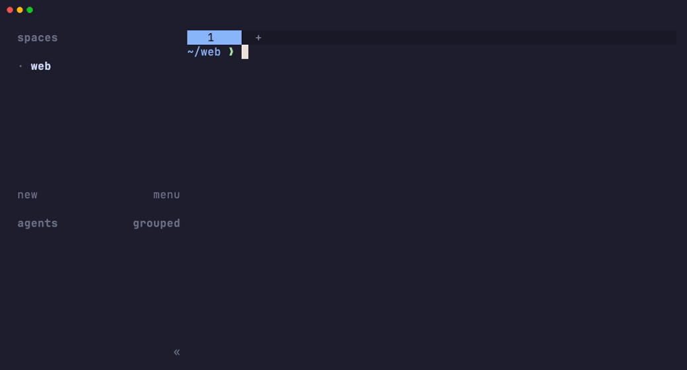
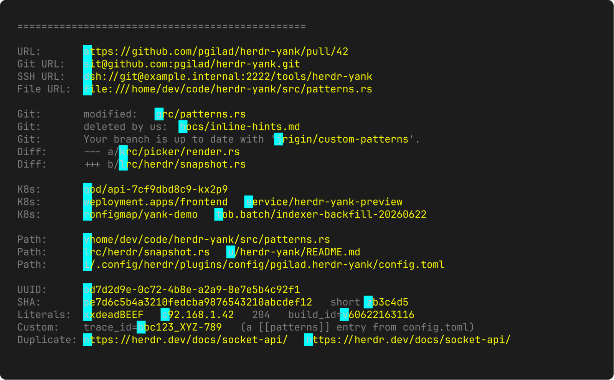

# Herdr Yank

[](https://github.com/pgilad/herdr-yank/actions/workflows/ci.yml)
[](https://github.com/pgilad/herdr-yank/releases/latest)
[](LICENSE)


<p align="center">
  <a href="#quick-start">quick start</a> · <a href="#picker-keys">keys</a> · <a href="#what-gets-a-hint">patterns</a> · <a href="#configuration">configuration</a> · <a href="#troubleshooting">troubleshooting</a>
</p>

**Copy anything on screen in a [Herdr](https://herdr.dev) pane, without the mouse.** Press a key and every URL, path, git SHA, UUID, and IP address gets a short hint. Type the hint and the text is on your clipboard. Open a URL or a file the same way.



Inspired by [tmux-fingers](https://github.com/Morantron/tmux-fingers). A fork of [rmarganti/herdr-pluck](https://github.com/rmarganti/herdr-pluck), see [what is different](#differences-from-upstream).

## Highlights

- **Two actions.** `yank` copies. `open-url` opens a URL in your browser, or a local file in its default app.
- **Home-row hints.** One letter for up to 26 matches, starting with `a` `s` `d` `f`. The same text always gets the same hint.
- **Knows terminal output.** URLs, paths, `git status` and diff file names, git SHAs, Kubernetes resources, UUIDs, IPs, and numbers. Add your own with a regex.
- **Copy several at once.** `Tab` starts multi-select and copies your picks, one per line.
- **Works over SSH.** Copies go through OSC 52 to the clipboard of the computer you type on. No `pbcopy` or `xclip` needed.
- **Safe by default.** `open-url` opens web URLs, web pages, PDFs, and images, never scripts. Yanked text never shows in a notification or a log.

## Quick start

1. **Install.** Releases ship prebuilt binaries for Apple Silicon Macs and Linux x86_64. Other systems build from source with Cargo (Rust 1.85+).

   ```bash
   herdr plugin install pgilad/herdr-yank
   ```

2. **Bind keys** in `~/.config/herdr/config.toml`:

   ```toml
   [[keys.command]]
   key = "prefix+y"
   type = "plugin_action"
   command = "pgilad.herdr-yank.yank"
   description = "yank visible token"

   [[keys.command]]
   key = "prefix+shift+y"
   type = "plugin_action"
   command = "pgilad.herdr-yank.open-url"
   description = "open visible URL or file"
   ```

3. **Use it.** Run `herdr server reload-config`, press `prefix` then `y`, and type a hint.

To update, run the install command again. Your config stays.

## Picker keys

| Key | Does |
| --- | --- |
| Hint letters | Copy or open that item |
| `Backspace` | Undo a typed letter |
| `Tab` | Start multi-select (`yank` only). Hints then toggle items |
| `Tab` or `Enter` | Copy the picked items, one per line |
| `Esc` or `Ctrl-C` | Cancel |

Hints grow to two letters past 26 matches, and to three past 676. After the first letter, only the hints that start with it stay visible.

## What gets a hint

Built-in patterns, in priority order. When two matches overlap, the higher row wins.



| Pattern | Matches | Copies |
| --- | --- | --- |
| `url` | `https://…`, `git@…`, `ssh://…`, `ftp://…`, `file://…` | the URL |
| `git-status` | `modified:   src/main.rs` | `src/main.rs` |
| `git-status-branch` | `Your branch is up to date with 'origin/main'.` | `origin/main` |
| `diff` | `+++ b/src/lib.rs` | `src/lib.rs` |
| `kubernetes` | `pod/web-1`, `deployment.apps/frontend` | the reference |
| `path` | `~/repos/app/README.md`, `src/lib.rs` | the path |
| `uuid` | `0d7d2d9e-0c72-4b8e-a2a9-8e7e5b4c92f1` | the UUID |
| `kubernetes-pod` | `api-7cf9dbd8c9-kx2p9` | the pod name |
| `git-sha` | 7 to 128 hex characters, so SHA-256 digests too | the SHA |
| `hex` | `0xdeadBEEF` | the literal |
| `ipv4` | `192.168.1.42` | the address |
| `number` | 4 or more digits | the number |

A URL in Markdown copies without the markup, and a `[text](target)` link gives its target as its own match.

`open-url` only gives hints to things that are safe to open:

- `http` and `https` URLs, in your default browser.
- Absolute or `~/` paths to existing `html`, `htm`, `pdf`, `svg`, `png`, `jpg`, `jpeg`, `gif`, or `webp` files.

Other files get no hint, because `open` and `xdg-open` would run a script or an app. Relative paths get no hint either, because the picker does not know the working directory of the pane. Use `yank` to copy them.

## Configuration

All settings are optional. They go in `config.toml` in the plugin config directory:

```bash
$EDITOR "$(herdr plugin config-dir pgilad.herdr-yank)/config.toml"
```

```toml
# Keep only some built-in patterns (default: all). Dropping "number" and "path" cuts the most noise.
enabled_builtin_patterns = ["url", "path", "git-sha", "git-status", "diff"]

# "auto" (default) | "osc52" | "tool"
clipboard = "auto"

# Your own pattern, in Rust regex syntax. A lower priority wins overlaps (default 25).
# A capture named "match" limits the copy: this copies abc123 from trace_id=abc123.
[[patterns]]
name = "trace-id"
regex = "trace_id=(?<match>[A-Za-z0-9_-]+)"
priority = 25
```

A setting with a problem, such as an unknown key or an invalid regex, shows a notification and is skipped. The other settings still apply. `herdr plugin log` lists every problem.

<details>
<summary><b>Clipboard modes</b></summary>

- `auto` copies with an OSC 52 escape. Herdr sends it to the clipboard of the attached client, so the text reaches your computer also when Herdr runs on a remote host. If OSC 52 is not possible, `auto` uses a clipboard command (`pbcopy`, `wl-copy`, `xclip`, or `xsel`) on the computer that runs the Herdr server.
- `osc52` uses only OSC 52.
- `tool` uses only a clipboard command.

An OSC 52 copy holds at most 196,602 bytes, the largest text that every supported Herdr version forwards. In `osc52` mode a longer selection is an error, not a partial copy. When the Herdr client itself runs over SSH, the outer terminal can have a lower limit.

</details>

<details>
<summary><b>Colors</b></summary>

These are the defaults. Set only the ones you want to change. Values are the sixteen standard terminal color names, `#RRGGBB`, or `ansi:N` for a 256-color palette entry.

```toml
[style]
unmatched_fg = "dark-grey"
match_fg = "yellow"
# match_bg = "#202020"   # no background by default
hint_fg = "black"
hint_bg = "cyan"
selected_match_fg = "white"
selected_match_bg = "dark-magenta"
selected_hint_fg = "white"
selected_hint_bg = "magenta"
status_fg = "black"
status_bg = "grey"
```

</details>

<details>
<summary><b>Project-local patterns (off by default)</b></summary>

Herdr Yank can also read `[[patterns]]` from `.herdr-yank.toml` files, from the working directory of the pane up to the Git root:

```toml
[project]
patterns = true
pattern_files = [".herdr-yank.toml"]
```

Turn this on only for repositories you trust. A project file is as trusted as the checkout, and a `priority = 1` pattern in it outranks every built-in, so it can change what a hint copies. Nothing in the file runs. A project file holds only `[[patterns]]`. For equal priorities, project patterns win over global ones, and global ones win over built-ins.

</details>

## Troubleshooting

- **No picker opens:** nothing on screen matched. A notification says so.
- **The key does nothing:** check that it does not clash with a Herdr default key. For example, `prefix+q` detaches. Then check that the action exists with `herdr plugin action list --plugin pgilad.herdr-yank`.
- **The copy fails:** the notification shows why. `clipboard = "tool"` needs a clipboard command, and `auto` needs a usable `/dev/tty` or a clipboard command.
- **"Checksum mismatch" during install:** the install refuses the download on purpose and builds from source. Do not work around it.
- **Anything else:** run `herdr plugin log`. Errors in the picker tab show as notifications.

## Development

`herdr plugin link` does not run build commands, so install the binary before you link a checkout:

```bash
./scripts/install-binary.sh                                  # download the release binary
HERDR_YANK_BUILD_FROM_SOURCE=1 ./scripts/install-binary.sh   # or build this checkout
herdr plugin link .
```

Run the script again after each change. To record `assets/demo.gif` again, run `scripts/record-demo.sh` (needs [VHS](https://github.com/charmbracelet/vhs)). Before you send a change, run `cargo fmt --all --check`, `cargo test --locked --workspace --all-features`, and `cargo clippy --locked --workspace --all-targets --all-features -- -D warnings`.

To release, set the same version in `Cargo.toml` and `herdr-plugin.toml`, then push a tag `v<version>`. The release workflow builds the binaries and publishes them with signed build provenance, which you can verify:

```bash
gh attestation verify herdr-yank-v1.0.0-aarch64-apple-darwin.tar.gz --repo pgilad/herdr-yank
```

## Differences from upstream

<details>
<summary>What this fork changes in <a href="https://github.com/rmarganti/herdr-pluck">rmarganti/herdr-pluck</a></summary>

- Project-local `.herdr-yank.toml` patterns are opt-in instead of on by default, and a project file holds only `[[patterns]]`.
- `Tab` multi-select copies several matches at once, joined by newlines.
- Backspace clears a mistyped hint prefix, and a typed prefix hides the hints that do not start with it.
- Hints widen to three characters past 676 matches instead of dropping the extra ones.
- An empty result shows a notification instead of a dead-end picker tab, and a failed copy or launch shows a notification instead of a message that disappears with the picker tab.
- The clipboard prefers OSC 52, so `pbcopy`/`xclip`/`wl-copy` are optional and a copy reaches your computer also with remote attach. Clipboard commands run detached from the picker pane, so `wl-copy` and `xclip` keep the selection after the pane closes.
- `enabled_builtin_patterns`, `clipboard`, and `[style]` are new keys. A config problem shows a notification, and the valid keys still apply.
- `git-sha` matches 7–128 hex characters, so SHA-256 and SHA-512 digests select as one token.
- `url` handles Markdown and parentheses, and `kubernetes` needs a `kind/name` reference.
- `open-url` opens only `http` and `https` URLs, and absolute or `~/` paths to existing web pages, PDFs, and images. `open` and `xdg-open` give a file to the default application of its type, which can start a program or a script, thus other file types and `file://` URLs stay refused. Use `yank` to copy them.
- The picker gets the content rows of the pane from Herdr and fits its output to its real terminal size, so non-default `ui.pane_borders`, `ui.pane_outer_borders`, `ui.pane_gaps`, `ui.pane_scrollbars`, and `ui.hide_tab_bar_when_single_tab` settings do not break it.
- Hardening: the temp pane snapshot uses mode `0600` and `O_EXCL` and is deleted at read time, the URL launcher re-checks the scheme allow-list and the file type of the real file before it spawns `open`/`xdg-open`, and a copy or launch failure reports the size of the selection rather than its text, so a yanked secret never reaches a notification or `herdr plugin log`.
- `install-binary.sh` checks the published `.sha256` before it extracts the archive, and releases carry signed build provenance for `gh attestation verify`.

</details>

## License

[MIT](LICENSE) © Gilad Peleg. Upstream [herdr-pluck](https://github.com/rmarganti/herdr-pluck) © Ryan Marganti.
